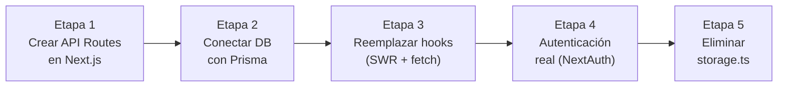

# Migración a base de datos externa — SIPnr

## Estado actual

El proyecto es **100% client-side**: todo el estado vive en `localStorage` del browser, manejado por `src/lib/storage.ts`. No hay ninguna llamada a red, ni API Routes de Next.js, ni servidor de base de datos.

```
Browser
  └── localStorage  ←→  storage.ts  ←→  useLibros / useSocios / usePrestamos / useDanos / useAuditoria
```

---

## ¿Puede conectarse a una base de datos externa?

**Sí, y Next.js 16 (App Router) está diseñado exactamente para eso.** Pero requiere una refactorización moderada. La buena noticia es que la arquitectura de hooks del proyecto es muy ordenada — toda la capa de datos está concentrada en `storage.ts` y los hooks de dominio, así que el trabajo está bien delimitado.

---

## Qué habría que cambiar

### 1. Reemplazar `storage.ts` por una capa de API

Hoy `storage.ts` hace `localStorage.getItem / setItem`. Eso se reemplaza por llamadas a una API propia.

Next.js App Router permite crear **API Routes** dentro del mismo proyecto en `src/app/api/`:

```
src/app/api/
  libros/route.ts        → GET /api/libros, POST /api/libros
  libros/[id]/route.ts   → PUT /api/libros/:id, DELETE /api/libros/:id
  socios/route.ts
  prestamos/route.ts
  danos/route.ts
  auditoria/route.ts
```

Estas rutas corren **en el servidor** (Node.js), pueden conectarse directamente a la base de datos con un ORM o driver, y el browser nunca toca la DB directamente.

### 2. Convertir los hooks de cliente a fetchers

Cada hook (`useLibros`, `useSocios`, etc.) hoy inicializa su estado desde `localStorage`. Pasarían a usar `fetch` contra la API propia, con `SWR` o `React Query` para cacheo y revalidación:

```ts
// Hoy
const [libros, setLibros] = useState<Libro[]>(() => storage.getLibros());

// Con DB
const { data: libros, mutate } = useSWR<Libro[]>('/api/libros', fetcher);
```

Las mutaciones (crear, editar, eliminar) pasarían a ser `fetch` con `POST/PUT/DELETE`.

### 3. Autenticación real

Hoy el login es hardcodeado en `LoginForm.tsx` (`adminmañana / 1234`). Con DB se movería a:
- **NextAuth.js** (más completo, soporta OAuth, credenciales, JWT, sesiones)
- O una tabla `admins` en la propia DB con contraseñas hasheadas (bcrypt)

---

## Opciones de base de datos compatibles

| Opción | Tipo | Hosting | Ideal para |
|--------|------|---------|------------|
| **PostgreSQL + Prisma** | Relacional | Supabase / Railway / Neon | Recomendado — Prisma genera los tipos TS automáticamente |
| **MySQL / MariaDB** | Relacional | PlanetScale / Railway | Similar al anterior |
| **SQLite** | Relacional | Mismo servidor | Simple, sin costo, pero no escala bien en multi-usuario |
| **MongoDB + Mongoose** | Documento | MongoDB Atlas | Si se prefiere esquema flexible |
| **Supabase** | PostgreSQL + API REST + Auth | Supabase | Todo-en-uno: DB, Auth, Storage |
| **Firebase Firestore** | Documento + Realtime | Google | Si se quiere sincronización en tiempo real |

> [!TIP]
> Para un proyecto escolar como SIPnr, **Supabase** o **PostgreSQL en Railway** son las mejores opciones: gratuitas en el tier inicial, fáciles de desplegar con Next.js, y Prisma genera automáticamente las interfaces TypeScript desde el esquema — lo que significa casi cero trabajo de tipado extra.

---

## Esquema de migración sugerido (por etapas)



### Etapa 1 — API Routes (sin DB todavía)
Crear los endpoints en `src/app/api/` que por ahora responden con datos hardcodeados o desde un JSON. Los hooks del frontend empiezan a consumirlos. Esto desacopla el frontend de `localStorage` sin tocar la DB aún.

### Etapa 2 — Conectar Prisma + DB
Instalar Prisma, definir el schema (que espeja los tipos de `src/types/index.ts`), hacer `prisma migrate`. Las API Routes empiezan a usar `prisma.libro.findMany()` etc.

### Etapa 3 — Reemplazar hooks
Cambiar `useState(() => storage.getX())` por `useSWR('/api/x', fetcher)`. Las mutaciones pasan a `fetch` + `mutate()`.

### Etapa 4 — Autenticación
Instalar NextAuth.js, configurar el provider de credenciales contra la tabla de admins en DB.

### Etapa 5 — Limpieza
Eliminar `src/lib/storage.ts` y la dependencia de `localStorage`.

---

## Lo que **no** cambia

- Todos los componentes React (modales, vistas, UI)
- Los tipos en `src/types/index.ts` — de hecho Prisma los genera automáticamente
- La lógica de negocio dentro de los hooks (morosidad, generación de IDs, etc.)
- El sistema de auditoría — solo cambia dónde se persiste

---

## Estimación de esfuerzo

| Tarea | Complejidad |
|-------|-------------|
| Crear API Routes + Prisma schema | Media |
| Migrar hooks a SWR/fetch | Media |
| Autenticación con NextAuth | Media-Alta |
| Testing e integración end-to-end | Baja |
| **Total estimado** | **1–2 semanas** de desarrollo |
