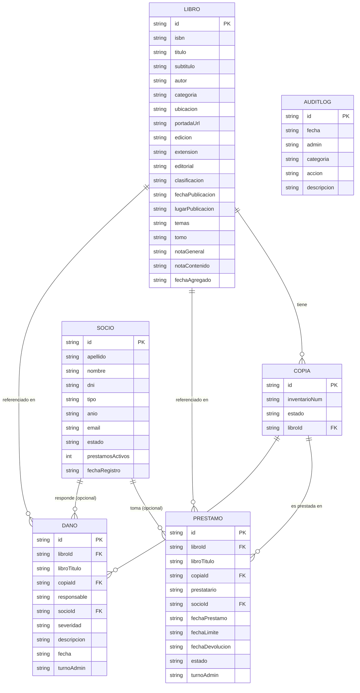

# Esquema Relacional — SIPnr

> Entidades principales: **Libro**, **Préstamo** y **Daño**.  
> Entidades de soporte: **Copia**, **Socio** y **AuditLog**.

---

## Diagrama ER



---

## Relaciones en detalle

### `LIBRO` → `COPIA` *(1 a N)*
Un libro puede tener **múltiples copias físicas** (cada una con su número de inventario y estado independiente).  
Las copias se almacenan embebidas en el objeto `Libro` como array `copias[]`.

---

### `COPIA` → `PRÉSTAMO` *(1 a N)*
Una copia puede haber sido prestada **varias veces** a lo largo del tiempo.  
`Prestamo.copiaId` y `Prestamo.libroId` identifican exactamente qué ejemplar físico salió.

| Campo en Préstamo | Referencia |
|---|---|
| `libroId` | `Libro.id` |
| `copiaId` | `Copia.id` (dentro de `Libro.copias`) |
| `libroTitulo` | Desnormalizado (snapshot al momento del préstamo) |
| `fechaLimite` | Calculada al crear el préstamo según el plazo configurado (default: 7 días) |

---

### `COPIA` → `DAÑO` *(1 a N)*
Una copia puede acumular **múltiples registros de daño** en el tiempo.  
`Dano.copiaId` y `Dano.libroId` identifican el ejemplar afectado.

| Campo en Daño | Referencia |
|---|---|
| `libroId` | `Libro.id` |
| `copiaId` | `Copia.id` |
| `libroTitulo` | Desnormalizado (snapshot) |

---

### `SOCIO` → `PRÉSTAMO` *(1 a N, opcional)*
Un préstamo puede estar vinculado a un socio registrado **o no**.  
`Prestamo.socioId` es opcional — permite préstamos a nombre libre (`prestatario`).

| Campo | Descripción |
|---|---|
| `socioId?` | Referencia a `Socio.id` (nullable) |
| `prestatario` | Nombre textual del receptor (siempre presente) |
| `fechaLimite` | Fecha de vencimiento; al superarse el préstamo pasa a **moroso** automáticamente |

> [!NOTE]
> El plazo de devolución se configura por préstamo al momento de registrarlo (campo `diasDevolucion`, por defecto 7 días). Solo se persiste la fecha resultante `fechaLimite`; el número de días no se guarda como campo propio.

---

### `SOCIO` → `DAÑO` *(1 a N, opcional)*
Un daño puede imputarse a un socio registrado **o no**.  
`Dano.socioId` es opcional — permite registrar responsables sin cuenta.

| Campo | Descripción |
|---|---|
| `socioId?` | Referencia a `Socio.id` (nullable) |
| `responsable` | Nombre textual del responsable (siempre presente) |

---

### `PRÉSTAMO` → `DAÑO` *(relación implícita)*
No existe una FK directa entre `Prestamo` y `Dano`, pero un daño se puede originar en la **devolución de un préstamo**.  
En ese caso, `useDashboard.registrarDevolucion()` llama internamente a `registrarDano()` propagando `socioId`, `libroId` y `copiaId` del préstamo.

```
Prestamo ──(devolución con daño)──► Dano
           [socioId, libroId, copiaId se copian]
```

---

### `AUDITLOG` *(entidad transversal)*
No tiene FK explícitas. Registra eventos de todas las demás entidades mediante la categoría:

| Categoría | Originado por |
|---|---|
| `Libros` | Alta / edición / eliminación de libros |
| `Préstamos` | Creación / devolución / eliminación |
| `Daños` | Registro de nuevo daño |
| `Socios` | Alta / edición / cambio de estado |
| `Sistema` | Login / logout |

---

## Estados y ciclo de vida

### Copia
```
disponible ──(préstamo)──► prestado ──(devolución)──► disponible
           └──(daño)──────► dañado
           └──(pérdida)───► perdido
```

### Préstamo
```
prestado ──(sin devolver en fecha)──► moroso
         └──(devolución)───────────► devuelto
```

### Socio
```
activo ──► suspendido ──► activo
       └──► inactivo
```

---

## Almacenamiento actual

Todos los datos persisten en **`localStorage`** mediante `storage.ts`. Las colecciones son arrays planos separados por clave:

| Clave localStorage | Entidad |
|---|---|
| `SIP_LIBROS` | `Libro[]` (incluye `copias[]` embebidas) |
| `SIP_SOCIOS` | `Socio[]` |
| `SIP_PRESTAMOS` | `Prestamo[]` |
| `SIP_DANOS` | `Dano[]` |
| `SIP_AUDIT_LOG` | `AuditLog[]` |
| `SIP_CURRENT_ADMIN` | Turno del admin activo |
| `SIP_AUTH_USER` | Usuario del admin activo |
| `SIP_AUTH_TIME` | Hora de ingreso de la sesión |

> [!NOTE]
> `Socio.prestamosActivos` se mantiene como campo persistido para compatibilidad, pero en la UI se **calcula dinámicamente** contando los préstamos en estado `prestado` o `moroso` vinculados al socio. En una migración a DB, este campo puede eliminarse del modelo y reemplazarse por una consulta derivada.

> Para migrar a una base de datos externa, cada clave corresponde a una tabla.  
> Ver `db-migration-analysis.md` para el plan completo de migración.

